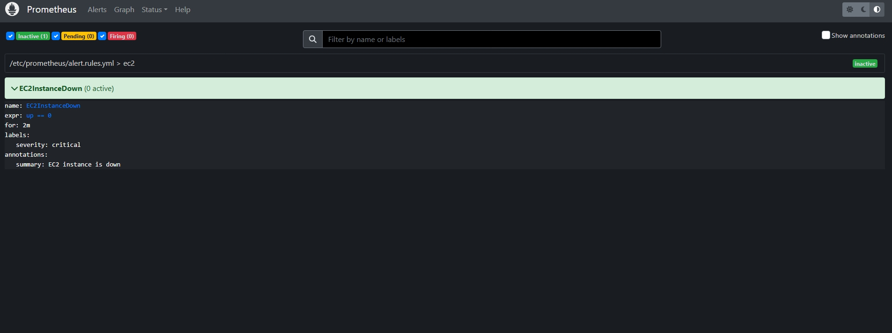
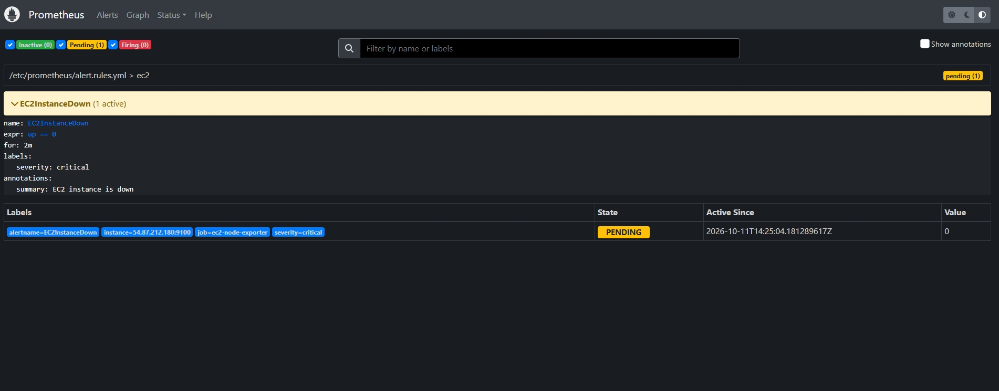
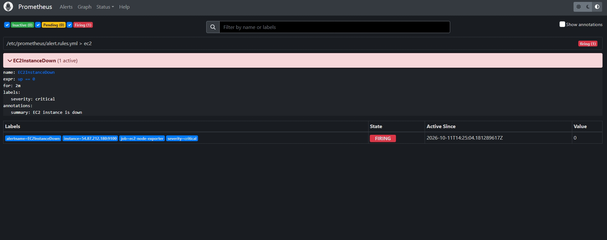
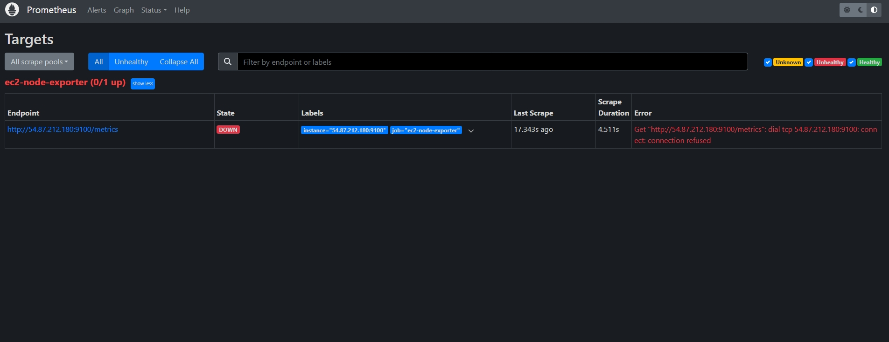
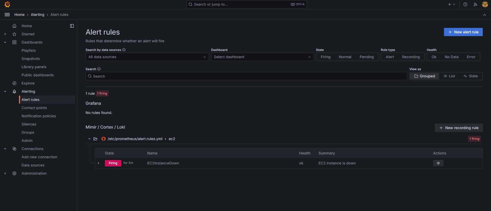

# Project 05: Monitoring and Observability (Prometheus & Grafana)

## Overview
This project adds a monitoring and observability layer to the DevOps Portfolio infrastructure. It collects real-time system and resource performance metrics from the AWS EC2 production server and visualizes them using Prometheus and Grafana dashboards.

---

## Architecture & Design Decisions

To maintain a zero-cost infrastructure under the **AWS Free Tier** (1x `t3.micro` instance with 1 GB RAM) while ensuring system stability, a hybrid architecture was implemented:

1. **Production Host (AWS EC2):** Runs the application container along with **Node Exporter**, exposing Linux OS metrics on port `9100`.
2. **Local Management Stack (WSL / Docker Compose):** Runs **Prometheus** and **Grafana** locally. Prometheus periodically scrapes metrics over HTTPS/TCP from the EC2 public endpoint.

### Why this architecture?
- **Resource Savings:** Running the complete Prometheus and Grafana stack alongside production applications on a single `t3.micro` instance risks causing Out-Of-Memory (OOM) crashes.
- **Security & Least Privilege:** Port `9100` is restricted in the AWS Security Group to the authorized management IP (`/32`), preventing public exposure of host internal metrics.

---

## Tech Stack
- **Prometheus (v2.51.0):** Metrics scraping, storage, and querying.
- **Grafana (v10.4.0):** Operational dashboards and data visualization.
- **Node Exporter:** Machine metrics collection (CPU, Memory, Disk, Network).
- **Docker Compose:** Local orchestration of the monitoring stack.
- **Terraform & AWS Security Groups:** Infrastructure as Code (IaC) for ingress traffic control.

---

## Repository Structure

```text
05-monitoring-prometheus-grafana/
├── docker-compose.yml
├── prometheus.yml
├── dashboards/
│   └── node-exporter.json
├── images
└── README.md
```

---

## Configuration Files

### 1. `docker-compose.yml`
This file orchestrates the local Prometheus and Grafana containers.

```yaml
services:
  prometheus:
    image: prom/prometheus:v2.51.0
    container_name: prometheus
    restart: unless-stopped
    ports:
      - "127.0.0.1:9090:9090"
    volumes:
      - ./prometheus.yml:/etc/prometheus/prometheus.yml
      - prometheus_data:/prometheus

  grafana:
    image: grafana/grafana:10.4.0
    container_name: grafana
    restart: unless-stopped
    ports:
      - "127.0.0.1:3000:3000"
    environment:
      - GF_SECURITY_ADMIN_PASSWORD=${GRAFANA_ADMIN_PASSWORD}
    volumes:
      - grafana_data:/var/lib/grafana

volumes:
  prometheus_data:
  grafana_data:
```

### 2. `prometheus.yml`
Configures the scraping jobs and target endpoints.

```yaml
global:
  scrape_interval: 15s

scrape_configs:
  - job_name: 'ec2-node-exporter'
    static_configs:
      - targets: ['54.87.212.180:9100']
```

---

## Step-by-Step Setup Guide

### Step 1: AWS Ingress Rule (Terraform)
Ensure your Terraform security group grants ingress access to port `9100` restricted strictly to your public IP:

```hcl
# Allow Prometheus Metrics from trusted management IP
resource "aws_vpc_security_group_ingress_rule" "allow_node_exporter" {
  security_group_id = aws_security_group.website_sh.id

  cidr_ipv4   = "my-ip" # Management Public IP
  from_port   = 9100
  ip_protocol = "tcp"
  to_port     = 9100
}
```

Apply the changes using your standard Git CI/CD workflow:
```bash
git add ec2.tf
git commit -m "feat(security): allow node-exporter port 9100 ingress"
git push
```

### Step 2: Start the Local Stack
Navigate to this project directory and launch the containers using Docker Compose:

```bash
cd 05-monitoring-prometheus-grafana
docker compose up -d
```

Verify that both containers are running:
```bash
docker ps
```

### Step 3: Verify Prometheus Scraping
1. Open your browser and navigate to: `http://localhost:9090/targets`
2. Confirm that the `ec2-node-exporter` target (`54.87.212.180:9100`) displays status **UP** in green.

### Step 4: Configure Grafana & Dashboard
1. Open Grafana at `http://localhost:3000` (Credentials: `user: ...` / `pass: saved in .env file`).
2. Navigate to **Connections > Data Sources > Add data source** and select **Prometheus**.
3. Set the **Prometheus server URL** to `http://prometheus:9090` and click **Save & test**.
4. Go to **Dashboards > New > Import**.
5. Enter ID **`1860`** (*Node Exporter Full*) or upload `./dashboards/node-exporter.json`.
6. Select your Prometheus data source and click **Import**.


## Alerting

One alert rule, in `alert.rules.yml`: if Prometheus can't scrape the exporter for 2 minutes in a row, the alert fires.

```yaml
- alert: EC2InstanceDown
  expr: up == 0
  for: 2m
  labels:
    severity: critical
  annotations:
    summary: "EC2 instance is down"
```

`up` is a metric Prometheus creates by itself for every target: 1 when the last scrape worked, 0 when it didn't. The `for: 2m` stops a single failed scrape from raising a false alarm. The file is mounted into the Prometheus container and loaded through `rule_files` in `prometheus.yml`.

### Testing it

To see it work I stopped the exporter on the instance (`docker stop node-exporter`) and watched the alert go through its states.

**Inactive.** The rule is loaded and the condition isn't true.



**Pending.** The condition is true and Prometheus is waiting out the 2 minutes.



**Firing.** After 2 minutes the alert fires.



The Targets page shows the reason: `connection refused`.



Grafana lists the same rule under Alert rules, because it reads the rules from the Prometheus data source. It's the same alert, not a second one.



### What this alert can't tell me

The name says "instance down", but what it really detects is the exporter not answering. In the test the instance was fine and the site container kept running the whole time (`docker ps` still showed it up). `connection refused` also means the machine answered and nothing was listening on port 9100. If the instance were unreachable, it would be a timeout instead. Knowing that the site itself stopped responding needs a check against the site, which is a next step.

There are no notifications either: the alert only shows on the Prometheus and Grafana pages. Sending it to email or Discord needs Alertmanager.

---

## Metrics Tracked (USE Method)
- **Utilization:** CPU usage, memory saturation, filesystem space usage.
- **Saturation:** Load average, IOPS queues.
- **Errors:** Network interface packet errors and drops.

